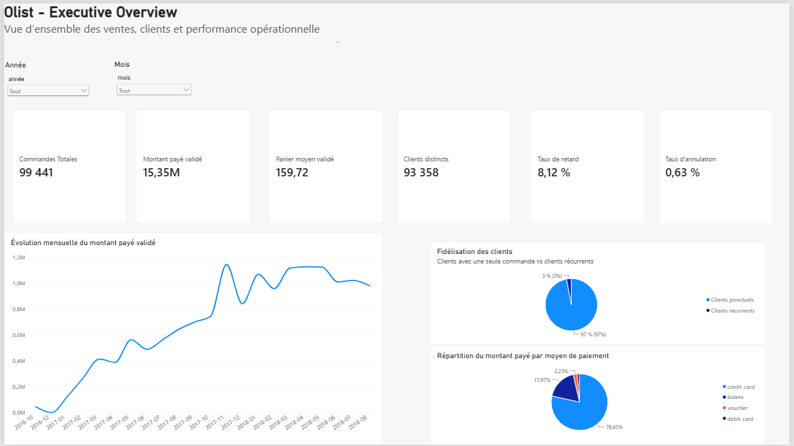
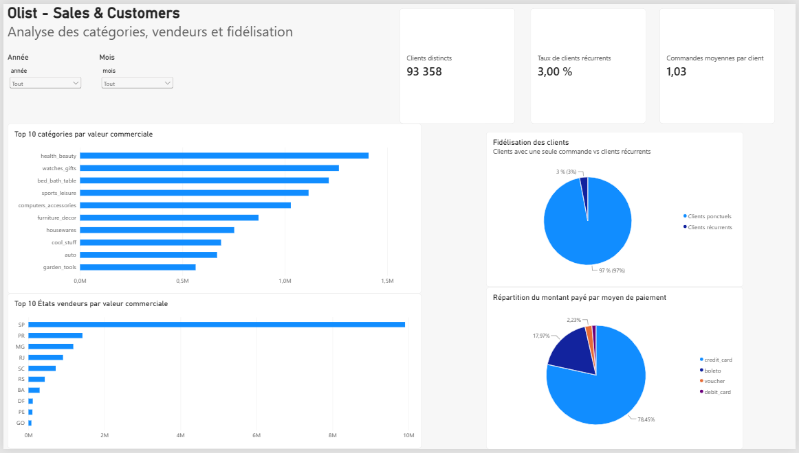
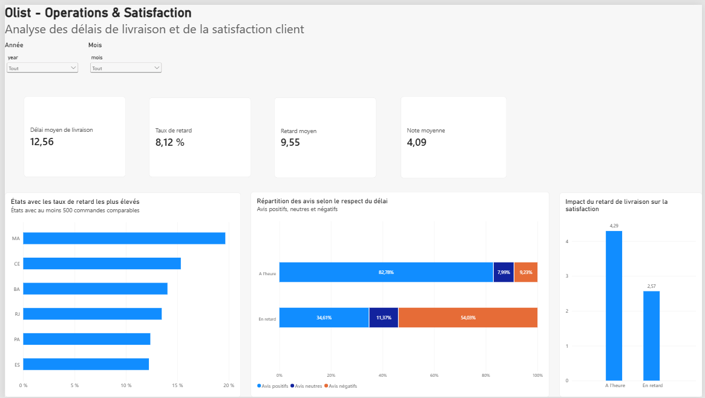
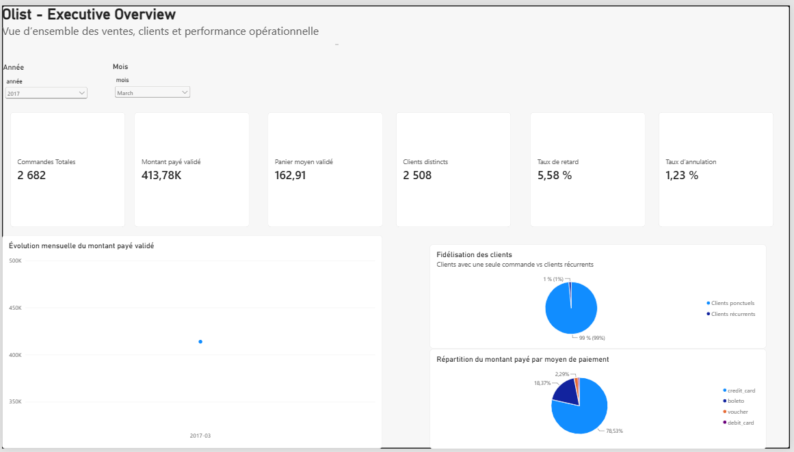

# Olist Data Reliability & BI

Projet personnel réalisé à partir du dataset public **Olist**.

Au départ, je voulais surtout travailler SQL sur un vrai dataset e-commerce. Le projet a finalement pris une forme plus complète : ingestion des fichiers dans PostgreSQL, profiling, contrôles qualité, nettoyage, création d’un modèle analytique, calcul des KPI puis dashboard Power BI.

L’idée était de ne pas directement faire des graphiques sur les CSV, mais de vérifier d’abord si les données étaient suffisamment fiables pour être utilisées.

## Stack

- PostgreSQL / DBeaver
- SQL
- Python
- Pandas / SQLAlchemy
- Power BI
- DAX
- Git / GitHub

## Pipeline

```text
CSV Olist
   ↓
Ingestion Python
   ↓
Tables de staging PostgreSQL
   ↓
Profiling SQL
   ↓
Contrôles qualité
   ↓
Vues nettoyées
   ↓
Modèle analytique
   ↓
KPI SQL
   ↓
Power BI / DAX
```

## Profiling et qualité des données

J’ai commencé par analyser les tables sans modifier les données sources.

Quelques chiffres du dataset :

- 99 441 commandes
- 112 650 lignes de commande
- 775 commandes sans article
- 1 359 cas où la date de remise au transporteur est antérieure à l’approbation
- 380 commandes avec un écart financier supérieur au seuil retenu
- 610 produits sans catégorie exploitable

Cette partie m’a surtout servi à décider quelles anomalies devaient être corrigées, lesquelles devaient simplement être signalées et lesquelles pouvaient rester dans le dataset.

J’ai ensuite créé des vues dédiées aux contrôles qualité, par exemple :

```text
vw_orders_quality
vw_reviews_quality
vw_products_quality
vw_payments_quality
vw_order_payment_quality
```

Les tables de staging restent intactes. Les corrections sont faites dans des vues séparées comme :

```text
vw_orders_clean
vw_products_clean
vw_reviews_clean
vw_payments_clean
vw_order_financial_clean
```

Un point important du projet concerne les paiements : je ne conserve un montant dans `validated_total_paid` que lorsque le montant payé est cohérent avec la valeur attendue de la commande.

## Modèle analytique

Après le nettoyage, j’ai créé un petit modèle analytique pour Power BI.

Dimensions :

```text
dim_customers
dim_products
dim_sellers
dim_date
```

Tables de faits :

```text
fact_orders
fact_order_items
fact_payments
```

J’ai aussi vérifié les relations entre les tables avant de les recréer dans Power BI.

## KPI principaux

Les KPI ont d’abord été calculés en SQL. Je les ai ensuite recréés en DAX pour vérifier que les résultats obtenus dans Power BI correspondaient bien aux résultats SQL.

Quelques valeurs :

- **99 441** commandes
- **96 478** commandes livrées
- **0,63 %** d’annulation
- **15,35 M** de montant payé validé
- **159,72** de panier moyen validé
- **93 358** clients distincts
- **3,00 %** de clients récurrents
- **12,56 jours** de délai moyen de livraison
- **8,12 %** de livraisons en retard
- **4,09 / 5** de note moyenne

### Fidélisation

C’est un des premiers résultats qui m’a surpris.

Sur les clients ayant au moins une commande livrée :

- 90 557 n’ont commandé qu’une seule fois
- 2 801 sont revenus
- le taux de clients récurrents est donc seulement de **3 %**

### Paiements

La carte bancaire représente environ **78 % du montant payé**.

Le paiement fractionné est également assez fréquent : environ **49 % des paiements exploitables** sont réalisés en plusieurs fois.

### Vendeurs

L’activité est très concentrée dans l’État de São Paulo.

Les vendeurs situés à SP représentent environ **64,5 % de la valeur commerciale analysée**.

### Livraison et satisfaction

C’est le résultat que je trouve le plus intéressant dans le projet.

Pour les commandes livrées à l’heure :

- note moyenne : **4,29 / 5**
- avis positifs : **82,78 %**
- avis négatifs : **9,23 %**

Pour les commandes en retard :

- note moyenne : **2,57 / 5**
- avis positifs : **34,61 %**
- avis négatifs : **54,03 %**

Il y a donc une forte association entre les retards de livraison et les mauvais avis.

Cela ne suffit pas à prouver que le retard est l’unique cause d’un mauvais avis, mais la différence entre les deux groupes est importante.

## Dashboard Power BI

J’ai construit trois pages.

### Executive Overview

Vue générale des commandes, paiements, clients, annulations et retards.



### Sales & Customers

Analyse des catégories produits, des vendeurs, des moyens de paiement et de la fidélisation.



### Operations & Satisfaction

Analyse des délais de livraison et de la satisfaction client.



Les pages peuvent être filtrées par année et par mois.

Exemple avec un filtre appliqué :



## Quelques mesures DAX

```DAX
Delivered Orders =
CALCULATE(
    [Total Orders],
    'public fact_orders'[order_status] = "delivered"
)
```

```DAX
Cancellation Rate =
DIVIDE(
    [Cancelled Orders],
    [Total Orders],
    0
)
```

```DAX
Repeat Customers =
COUNTROWS(
    FILTER(
        VALUES('public dim_customers'[customer_unique_id]),
        CALCULATE([Delivered Orders]) > 1
    )
)
```

```DAX
Late Delivery Rate =
DIVIDE(
    [Late Orders],
    [Comparable Delivered Orders],
    0
)
```

## Limites

Quelques points sont à garder en tête :

- 2016 et 2018 ne sont pas des années complètes dans le dataset ;
- certains calculs financiers excluent les commandes qui ne passent pas les contrôles de réconciliation ;
- certaines analyses de livraison excluent les dates manquantes ou incohérentes ;
- pour l’analyse des retards par État, je garde uniquement les États avec au moins 500 commandes comparables ;
- le lien entre retard et satisfaction correspond à une association, pas à une preuve de causalité.

## Structure du repo

```text
olist-data-reliability-project/
│
├── docs/
│   ├── images/
│   ├── analytical_model_notes_final.md
│   ├── analytical_model_summary_final.md
│   ├── business_kpi_notes.md
│   ├── business_kpi_summary.md
│   ├── cleaning_transformations_notes.md
│   ├── cleaning_transformations_synthese.md
│   ├── data_profiling_notes.md
│   ├── data_profiling_summary.md
│   ├── data_quality_note.md
│   └── data_quality_synthese_note.md
│
├── powerbi/
│   └── olist_data_analysis.pbix
│
├── scripts/
│   └── ingest.py
│
├── sql/
│   ├── 01_data_profiling.sql
│   ├── 02_data_quality.sql
│   ├── 03_cleaning_transformations.sql
│   ├── 04_analytical_model.sql
│   └── 05_business_kpi.sql
│
├── .gitignore
└── README.md
```

Les fichiers CSV et les informations de connexion PostgreSQL ne sont pas versionnés sur GitHub.